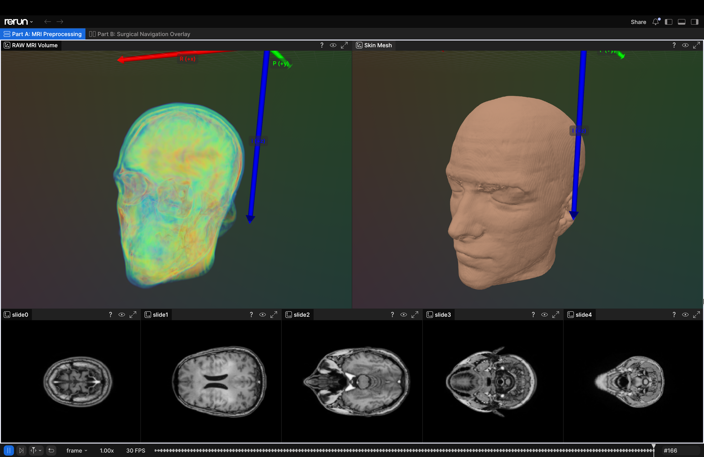
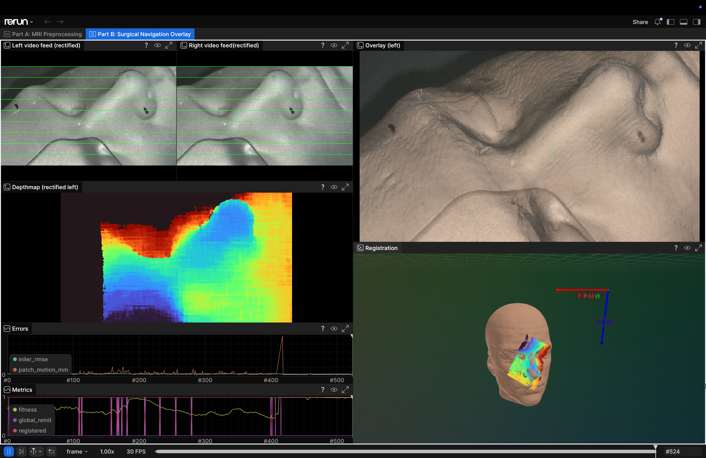

# Alberto / XRLabs : Interview task

**Contents**
- [Environment set up](#environment-set-up)
  - [Suggested data structure](#suggested-data-structure)
- [Running the pipeline](#running-the-pipeline)
- [Expected outputs](#expected-outputs)
  - [3D visualization with Rerun](#3d-visualization-with-rerun)
  - [Local disk save](#local-disk-save)
  - [Terminal output](#terminal-output)

A design writeup is at [DESIGN.md](DESIGN.md)
## Environment set up
Get the code first
```bash
git clone https://github.com/alberto-rota/XRLabsTask.git
```
Code comes with a `pyproject.toml` for reproducing the python environment and dependencies.
I use [uv](https://docs.astral.sh/uv/getting-started/installation/) to manage my environments. After installing it (`uv --version` works ), run:
```bash
uv sync 
```
in the directory you just cloned. It reads the `pyproject.toml` file, solves depencencies, installs the correct python interpretcreates a virtual environment and installs. 

> [!NOTE]
> If you want to use plain `pip` or `conda` create a **Python 3.14** venv in your preferred way and just `pip install -r requirements.txt` in your environment. The requirements file mimics the dependency session of the `pyproject.toml`

THe key dependencies:
- `pydicom` for reading the .dcm slices
- `numpy`, `scipy`, `scikit-image` for the volume processing and marching cubes
- `opencv-python` for rectification, stereo matching and video I/O
- `open3d` for point clouds, FPFH features, RANSAC/ICP registration and raycasting the overlay
- `rerun-sdk` for the visualization (more on this below)
- `rich` for the colored terminal output and progress bars, `json5` for reading the commented camera params

### Suggested data structure
There are three main inputs to the task, and their path must be passed as a CLI arg in order for the script to pick them up. However, putting them into a `data/` folder with the following names makes the pipeline pick them up automatically. 

```
data/
├── Aneurysm_MRI/                  # the .dcm slices
├── surgical_navigation_task.avi   # side-by-side stereo video
└── camera_params.jsonc            # stereo calibration
```

`camera_params.jsonc` is just the `Camera params at focus level (401 mm).txt` file that was provided, re-written by me as JSON so it can be parsed. 

## Running the pipeline
Make sure your virtual environment is sourced (`source .venv/bin/activate`).

To run Part A only:
```bash
python main.py --part_a --data_dir <DICOM_DIR_PATH>
```
Part B requires the output of Part A. Run them in sequence as:
```bash
python main.py --data_dir <PATH_TO_DICOM_DIR> --video_path <PATH_TO_VIDEO> --camera_params <PATH_TO_CAMERA_JSON>
```

The full set of CLI args and override is available with
```bash
python main.py --help
```
Most of them are described below and in the [design write-up](DESIGN.md)

## Expected outputs
#### 3D visualization with Rerun
Launching any program (MRI volume, skin mesh, rectified frames, depth maps, the registration in 3D, the overlay and the error plots) are shown in [Rerun](https://rerun.io/), a 3D visualization tool that I use all the time. It comes as a python package with the project dependencies. Launching the pipeline will open a window that looks like this one from part A



and this one for Part B



There are two tabs at the top of the viewer:
- **Part A: MRI Preprocessing**: raw MRI volume rendering, the extracted skin mesh with the RPI axes drawn on it (R in red, P in green, I in blue), and 5 axial slices
- **Part B: Surgical Navigation Overlay**: rectified left/right frames (with green horizontal lines to check the rectification by eye), the depth map, the error/metrics time series, the overlay on the left frame, and a 3D view where the depth map camera is placed on the MRI mesh by the registration

Use the timeline at the bottom to move across frames (for part B)

> [!NOTE]
> The viewer is a separate native window that launches seamlessly if you run this on a box with a display (I assime your laptop). If you wanna run it on a headless machine, let me know and I can have it open in a browser window

> [!IMPORTANT]
> Logging a high-resolution high-fps video on rerun might overflow the cache limit, which will mean that viewer will delete the oldest video frames in order to the show the most recent. This depends also on the hardware specs of your box. A workaround is setting `--viewer_image_res_down=4` to a higher value, which will log frames, depthmaps and overlay to 1/4 the resolution.  It's 3 by default which I think wont cause you issues.

---
#### Local disk save
Results from both pipelines are saved on disk. The default output directory is `out/` and can be overridden with `--out_dir`. The Part A files and the registration summary (`registration_metrics.json`, `registration.npz`) are always written. Saving the per-frame images (frames, depth maps, overlays) does not happen by default (for the sake of time), but it can be toggled by passing the `--save_frames`, `--save_depthmaps`, `--save_overlays` and `--save_video_overlay` CLI args.

Expected output files from Part A (always saved): 
- `transforms.json`: `vox2pat`, `to_rpi`, `vox2pat_rpi`, the detected orientation and the original DICOM metadata
- `volume.npy`: the raw volume
- `skin_mesh.npz`: vertices, triangles and normals of the skin mesh

Expected output files from Part B: 
- `registration_metrics.json`: summary of the registration over the whole run (failure rate, fitness, inlier RMSE, frame-to-frame motion, timings)
- `registration.npz`: per-frame camera-to-MRI pose and all the metrics
- `overlays/`, `overlay_video.mp4`: the overlay on the rectified left frame (with `--save_overlays` and `--save_video_overlay`)
- `left/`, `right/`, `depthmaps/`: rectified frames and depth maps as .npy (with `--save_frames` and `--save_depthmaps`)

---
#### Terminal output
Some intermediate output is shown in the terminal


